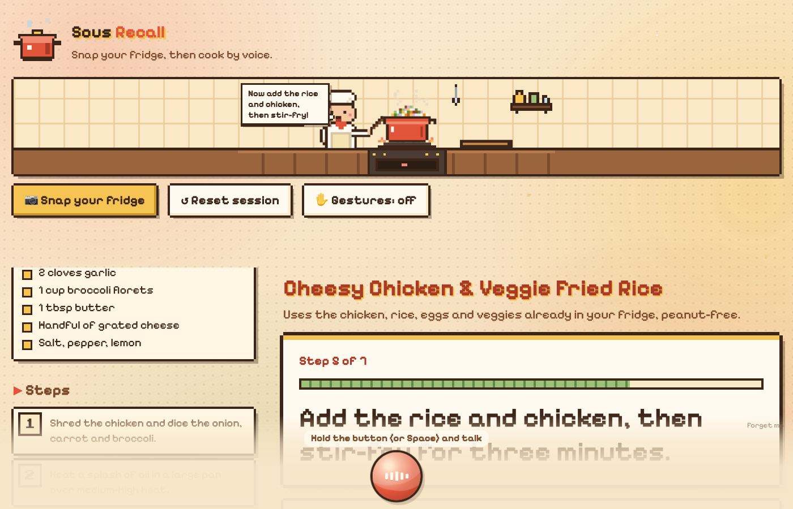
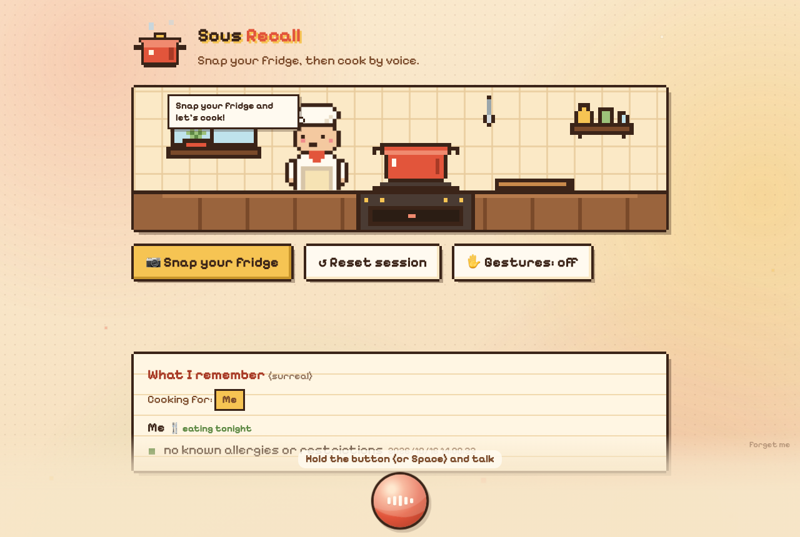
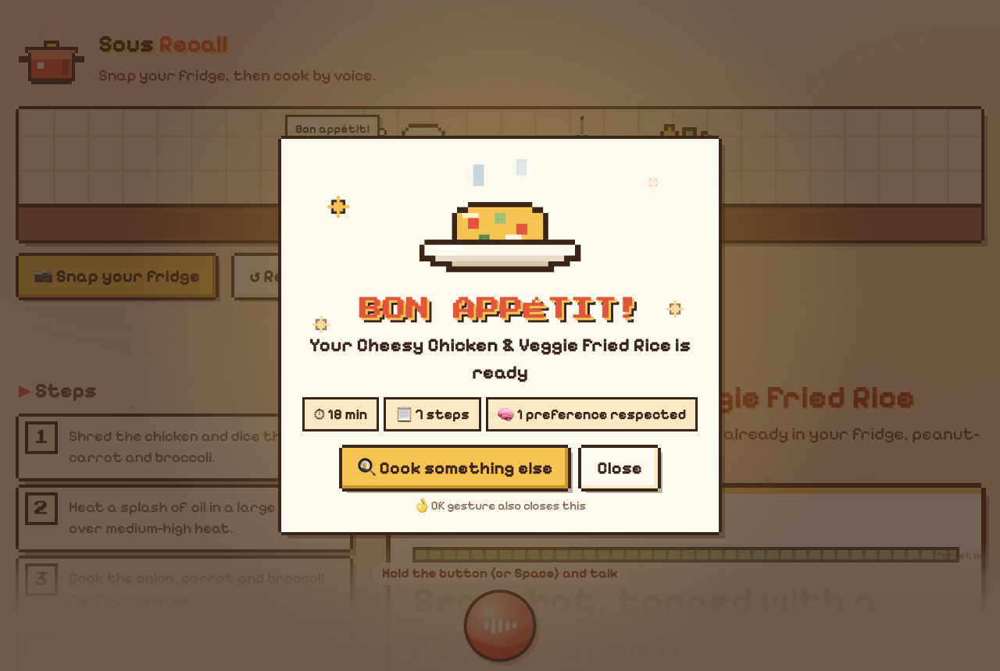
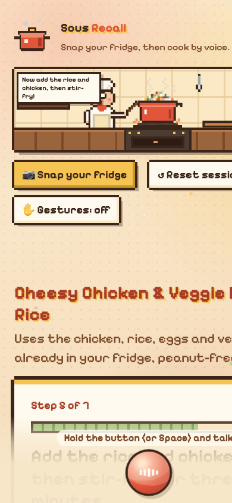

# 🍳 Sous Recall

**A hands-free sous-chef with a memory.** Snap a photo of your fridge, get a simple recipe built from what you actually have, then cook the whole thing by voice or hand gestures, without touching the screen with messy hands. Sous Recall remembers everyone's allergies and dislikes across sessions, lets newer preferences replace older ones, and checks every recipe and reply against them.



| Start screen | Finished dish | Phone |
|---|---|---|
|  |  |  |

---

## The problem

When you cook, your hands are covered in raw chicken, flour or oil. Recipe apps still expect you to scroll, tap "next" and unlock your phone. They also forget that you're allergic to peanuts, or that your friend coming over tonight is vegetarian.

## What Sous Recall does

| | |
|---|---|
| 📷 **Photo → recipe** | Claude (vision) looks at your fridge and suggests one dish (under 30 min) using what it sees, with 5–8 short steps written to be read aloud. |
| 🗣️ **Cook by voice** | Hold the orb (or Space) and talk: "done", "say that again", "how much salt?". Claude decides *next / repeat / answer* and ElevenLabs reads the reply. |
| 🖐️ **Cook by gesture** | Turn on the webcam: 👌 OK = next step, ✋ open hand = start talking, ✊ fist = send. Hand tracking runs fully in the browser. |
| 🧠 **Memory that updates** | "I'm allergic to peanuts" is remembered in SurrealDB Agent Memory. "I love spicy food" → later "I don't eat spicy anymore" *supersedes* the old fact (shown struck through, with timestamps) instead of piling up. |
| 👥 **Cooking for others** | "Tonight I'm cooking for me and Alex, he's vegetarian" stores Alex's preference and makes both of you tonight's diners. Every recipe respects everyone at the table. |
| 👋 **First-time onboarding** | New user? Before the first recipe it asks "Do you have any allergies or foods you avoid?", then cooks the waiting photo. Returning users skip this. |
| ✅ **Every answer is checked** | An LLM judge checks each recipe and reply against the diners' preferences. The UI shows "✅ Checked against N preferences" or "⚠️ reason", and the result is logged as an eval in Arize AX. |
| 🎨 **Cozy pixel UI** | A pixel kitchen whose pot fills up as you cook (flames when heating, a chopping knife when prepping), a little chef that listens, thinks and talks, a breathing voice orb, and a "Bon appétit!" ending. |

## 2-minute demo script

1. Click **Forget me** (bottom right) to start as a brand-new user.
2. **Snap your fridge** (or upload [`test_fridge.jpg`](test_fridge.jpg)). The chef asks about allergies.
3. Say *"I'm allergic to peanuts."* The memory panel updates, and the recipe appears with a smooth transition and is read aloud.
4. Say *"Done, what's next?"* or show 👌. The step advances, the pot fills, the flames turn on.
5. Say *"How much salt?"*. You get an answer for the current step, with a ✅ badge.
6. Say *"I love spicy food"*, then *"Actually, I don't eat spicy food anymore."* The old fact is struck through.
7. **Reset session**, then say *"Tonight I'm cooking for me and Alex, he's vegetarian."* Snap the same fridge (it has chicken). You get a vegetarian, peanut-free recipe.
8. Ask *"Can I add chicken to Alex's portion?"*. It says no and suggests eggs instead.
9. Finish the last step and see **Bon appétit!**. Then open Arize AX to see the traces and pass/fail evals.

> No API keys handy? Open **`http://localhost:8000/#demo`** (or `#demo-done`) for a sample session that calls no APIs.

---

## How it works

```
 Browser: static/index.html (vanilla JS, no build)
   📷 photo ──┐   🎤 push-to-talk / ✋ gestures (MediaPipe, in-browser) ──┐   🧠 memory panel   🔊 <audio> stream
              ▼                                                          ▼          ▲                  ▲
 ┌──────────────────────────────── FastAPI · main.py (single process) ────────────────────────────────────┐
 │ POST /recipe ─┬─ no memory yet? → ask onboarding question, keep the photo                              │
 │               └─ llm.generate_recipe(photo, merged diner prefs)  ── Claude Sonnet (vision)             │
 │ POST /talk ──── voice.transcribe ── ElevenLabs STT (scribe_v1)                                         │
 │               ├─ onboarding? llm.onboard → typed facts → memory.add_preferences → cook waiting photo   │
 │               └─ llm.chat(recipe, step, diners' prefs, last 6 turns) ── Claude Haiku                   │
 │                     → {reply, action: next|repeat|answer|none, new_preference{person,fact}, diners}    │
 │ POST /next ──── 👌 gesture: advance a step, no LLM needed                                              │
 │ GET  /tts ───── voice.speak_stream ── ElevenLabs TTS (eleven_flash_v2_5), streamed, ~0.2 s to sound    │
 │ background ──── memory.add_preference (supersede check + SurrealDB write)                              │
 │               └ preference_check: LLM-as-judge → eval.label pass/fail → UI badge via GET /eval/{id}    │
 │ state (in memory): recipe, current_step, history, diners, mode, pending_image                          │
 └───────┬───────────────────────────────────┬──────────────────────────────────────┬─────────────────────┘
         ▼                                   ▼                                      ▼
   Anthropic Claude                 SurrealDB Agent Memory                     Arize AX
   recipe · chat · judge            /facts · /query · per-person facts         OpenTelemetry spans + evals
                                    (memory.json = fast local cache)
```

### How preferences supersede each other

1. A new fact (for example `me: doesn't eat spicy food anymore`) is compared by the LLM with that person's current facts (`llm.find_superseded`). The LLM returns the ones it contradicts or updates.
2. Old facts are marked `superseded_at` / `superseded_by` and kept for history. The UI shows them struck through.
3. SurrealDB gets the new fact via `POST /facts` (`infer: "full"`, `observed_at`, so the platform also does its own extraction and reconciliation). It also gets a timestamped retraction chunk for each superseded fact, so the full history lives in SurrealDB.
4. On a new machine, the local cache is rebuilt by recalling from SurrealDB and replaying preference, retraction and reset chunks in time order.

We rely on the LLM for supersede decisions. In testing, SurrealDB's native attribute reconciliation sometimes over-merged unrelated facts. It once filed "allergic to peanuts" as a correction of "loves spicy food" because both landed on the same `dietary_preference` key. So we record the native `corrections` on each fact, but the LLM decision is the one we trust.

### Latency (measured with live APIs)

| Voice turn | Before tuning | Now |
|---|---|---|
| Normal question ("how much salt?") | ~4 s | **~1.5 s text, +0.2 s to first audio** |
| Turn that adds a preference | ~10 s | **~2 s** |

How we got there: memory writes and evals run in background tasks after the reply is sent. TTS is streamed from `/tts` instead of base64. The per-turn controller uses Claude Haiku, while recipe vision stays on Sonnet.

---

## Sponsor tools: how each one is used

**ElevenLabs.** The voice loop. `voice.transcribe()` sends each push-to-talk recording to **Speech-to-Text (`scribe_v1`)**. `voice.speak_stream()` streams every reply through **Text-to-Speech (`eleven_flash_v2_5`)** to the browser, so playback starts on the first chunk. Both calls are traced (`elevenlabs_stt`, `elevenlabs_tts_stream`) with latency attributes.

**SurrealDB Agent Memory.** Long-term, per-person dietary memory (`memory.py`). Writes use `POST /facts` with `infer: "full"`, `observed_at` and a scope. Reads use `POST /query` with a scope `lens` and `includeDuplicates` (needed so identical facts re-added later aren't deduped away). Supersession is stored as timestamped retraction chunks, and "Forget me" writes a timestamped reset marker so a rebuilt cache starts empty. `MEMORY_BACKEND=local` swaps in a JSON file with the same behaviour.

**Arize AX.** Observability and evals. `arize.otel.register()` and the OpenInference `AnthropicInstrumentor` trace every Claude call. Each request has a parent span (`recipe_request`, `voice_turn`, `gesture_next`) with `transcript`, `action`, `current_step`, `preferences`, `new_preference` and `diners`. Every recipe and reply gets a `preference_check` child span (LLM-as-judge) with `eval.label` = `pass`/`fail` and `eval.explanation`, so preference violations can be filtered in Arize.

**Anthropic Claude.** All of the reasoning: **Sonnet** for vision (fridge photo → recipe JSON). **Haiku** for the per-turn voice controller (next/repeat/answer, preference and diner extraction), supersede detection, onboarding answers, and the preference judge. JSON parsing is defensive: it strips code fences, extracts the outer `{…}`, and retries once.

**AWS.** The SurrealDB Agent Memory context runs on SurrealDB Cloud in AWS `us-west-2`. The app calls Claude through the Anthropic API. Switching to Claude on Amazon Bedrock would only require swapping `Anthropic()` for `AnthropicBedrock()` in `llm.py`.

---

## Run it locally

Requires Python 3.11 (`uv` will download it) and Chrome (for the mic, camera and View Transitions).

```bash
git clone https://github.com/zh315-bit/Sous-Recall.git && cd Sous-Recall
uv venv -p 3.11 .venv && source .venv/bin/activate
uv pip install -r requirements.txt
cp .env.example .env        # fill in your keys
python main.py              # → http://localhost:8000
```

| Variable | Purpose |
|---|---|
| `ANTHROPIC_API_KEY` (+ `ANTHROPIC_WORKSPACE_ID` only for user-level `sk-ant-usr-` keys) | Claude |
| `MODEL` (default `claude-sonnet-5-5`), `CHAT_MODEL` / `JUDGE_MODEL` (default `claude-haiku-5-5`) | model choice per task |
| `ELEVENLABS_API_KEY` (needs Speech-to-Text + Text-to-Speech permissions), `VOICE_ID` | voice |
| `MEMORY_BACKEND` (`surreal` or `local`), `SPECTRON_URL`, `SPECTRON_CONTEXT_ID`, `SPECTRON_API_KEY`, `MEMORY_SCOPE` | SurrealDB Agent Memory |
| `ARIZE_SPACE_ID`, `ARIZE_API_KEY` | Arize AX tracing (optional: the app runs without it) |

SurrealDB: register the memory scope once with the CLI (or `POST /api/v1/<context>/scopes` with `{"path": ...}` for each level: `app`, `app/handsfree-chef`, …):

```bash
agent-memory scopes create app/handsfree-chef/user/default --url "$SPECTRON_URL" --api-key "$SPECTRON_API_KEY" --context-id "$SPECTRON_CONTEXT_ID"
```

Useful checks:

```bash
curl localhost:8000/health        # tracing on? which memory backend / model?
python memory.py "I love spicy food" "I don't eat spicy food anymore" "alex: vegetarian"
```

The mic and camera need `localhost` or HTTPS.

## API

| Endpoint | What it does |
|---|---|
| `POST /recipe` (multipart `image`) | recipe JSON + intro `audio_url`, or `{needs_onboarding, reply}` for a first-time user |
| `POST /talk` (multipart `audio`) | `{transcript, reply, action, current_step, new_preference, diners, eval_id, finished, audio_url}`; during onboarding it also returns `recipe` |
| `POST /next` | advance one step and read it (👌 gesture) |
| `GET /tts?text=` | streamed mp3 |
| `GET /eval/{id}` | background preference check: `pending` / `pass` / `fail`, reason, N |
| `GET /preferences` | `{backend, diners, current: {person: [facts]}, history}` |
| `POST /reset` · `POST /memory/reset` | clear tonight's session · forget all preferences |
| `GET /health` · `GET /state` | status · debug state |

## Project structure

```
main.py            FastAPI app: endpoints, session state, tracing setup, background evals
llm.py             Claude prompts: recipe (vision), voice controller, onboarding, supersede, judge
voice.py           ElevenLabs STT + streaming TTS
memory.py          per-person preference memory: SurrealDB Agent Memory + local JSON cache
static/index.html  the whole UI: pixel kitchen, voice orb, gestures, animations (vanilla JS + CSS)
docs/              README screenshots
test_fridge.jpg    sample fridge photo for demos
```

## Limitations and next steps

- Single user, single process, no auth: it's a hackathon build, and session state lives in memory.
- Each step has no timer yet. A per-step countdown ring, and highlighting the ingredients used in the current step, are the next things to build.
- Speech-to-text (~1–1.7 s) is now the largest latency left. A streaming STT would cut it further.

---

Built at a hackathon with FastAPI, vanilla JS, Anthropic Claude, ElevenLabs, SurrealDB Agent Memory and Arize AX.
